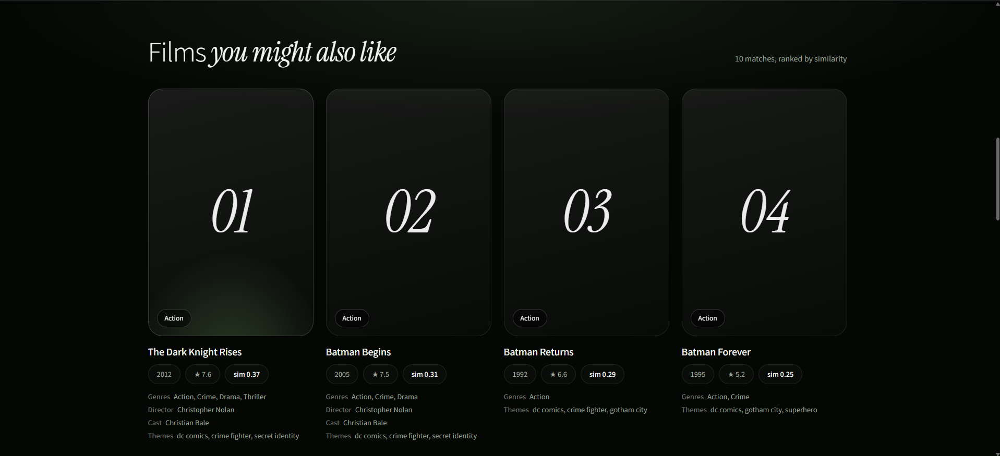

# ◼ CINEMATCH: Movie Recommendation System

A content-based movie recommender. Pick a movie and get the most similar ones, with a clear reason for each match (shared genres, director, cast, themes). Built with Pandas, NumPy and Scikit-learn on the TMDB 5000 Movies dataset, with a monochrome Streamlit interface.



**Live demo:** https://movie-recommender-ayush-1.streamlit.app/

## How it works

1. **Merge and clean** the TMDB movies and credits files, parsing the JSON-style columns (genres, keywords, cast, crew).
2. **Build one text profile per movie** from: the plot overview (lowercased, stop words removed, Porter-stemmed), genres, keywords, top 3 billed cast, and the director. Multi-word names are joined into one token (e.g. `ChristopherNolan`, `ScienceFiction`) so they match exactly.
3. **Vectorize with TF-IDF** (`min_df=2`, sublinear term frequency) and L2-normalize, so cosine similarity is a fast sparse dot product.
4. **Recommend**: score the chosen movie against all others, take the top N, and explain each match by listing the features the two movies share.

Design note: the full 4,800 x 4,800 similarity matrix is never stored (about 92 MB). Only the sparse feature matrix is saved, and similarities are computed per query in well under a millisecond, which keeps the repo small and the app easy to deploy.

## Setup

```bash
python -m venv venv
source venv/bin/activate        # Windows: venv\Scripts\activate
pip install -r requirements.txt
```

**Get the data (free):**
1. Go to https://www.kaggle.com/datasets/tmdb/tmdb-movie-metadata and click Download.
2. Unzip and put `tmdb_5000_movies.csv` and `tmdb_5000_credits.csv` into the `data/` folder.

**Build the model and run the app:**

```bash
python build_model.py
python -m streamlit run app.py
```

**Optional: posters.** Get a free API key at https://www.themoviedb.org/settings/api, copy `.env.example` to `.env`, and paste the key. Without a key the app still works and shows numbered cards instead of posters.

## Evaluation

Real users' ratings aren't part of this dataset, so I evaluate whether recommendations stay on-topic. Because genres are part of the final model's features, measuring genre overlap on that model would be circular. Instead, `evaluate.py` compares feature variants that **exclude genres** and measures how often their top-10 recommendations still share genres with the query movie, over 500 random query movies, against a random baseline.

```bash
python evaluate.py
```

**Results (500 random query movies):**

| Variant (genres excluded from features) | share@10 | jaccard@10 |
|---|---|---|
| Random baseline | 0.506 | 0.167 |
| Overview only, TF-IDF | 0.670 | 0.279 |
| Overview + keywords + cast + director, Count | 0.693 | 0.302 |
| Overview + keywords + cast + director, TF-IDF | 0.721 | 0.319 |

- *share@10*: fraction of recommended movies sharing at least one genre with the query
- *jaccard@10*: average overlap between the query's genres and each recommendation's genres
- Final model catalog coverage@10: 99.8% of movies appear in at least one top-10 list
- Average query time: 0.5 ms

**Observations:** TF-IDF with all features scored best, sharing a genre with the query 72% of the time versus 51% for random picks. The gap between TF-IDF and plain counts is small (about 3 points) and comes from a single run, so it isn't a large difference. Genre agreement is a proxy, because the dataset has no user ratings, so a recommendation can be on-topic without being one a person would enjoy.

## What I learned

- Genres are part of the model, so checking genre overlap on that model would be circular. The evaluation compares versions without genres to avoid this.
- Plain counts and TF-IDF performed similarly, so feature choice mattered more than weighting.
- Content-based filtering can't learn from what users actually enjoy, unlike collaborative filtering.

## Project structure


```
build_model.py   Load and clean data, build features, save artifacts
recommender.py   Recommendation and explanation logic
evaluate.py      Genre-agreement evaluation with random baseline
app.py           Streamlit interface
artifacts/       Saved model (movies.pkl, vectors.npz), commit these for deployment
```

## Possible extensions

- Hybrid model: blend content similarity with a popularity or rating prior
- Weighted features (e.g. boost director and genres)
- Sentence-embedding model for plot similarity, compared against TF-IDF with this same evaluation
- Collaborative filtering on MovieLens ratings, with precision@k against held-out ratings

*Data: TMDB 5000 Movie Dataset (Kaggle). This product uses the TMDB API but is not endorsed or certified by TMDB.*
